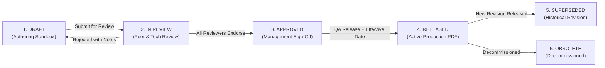
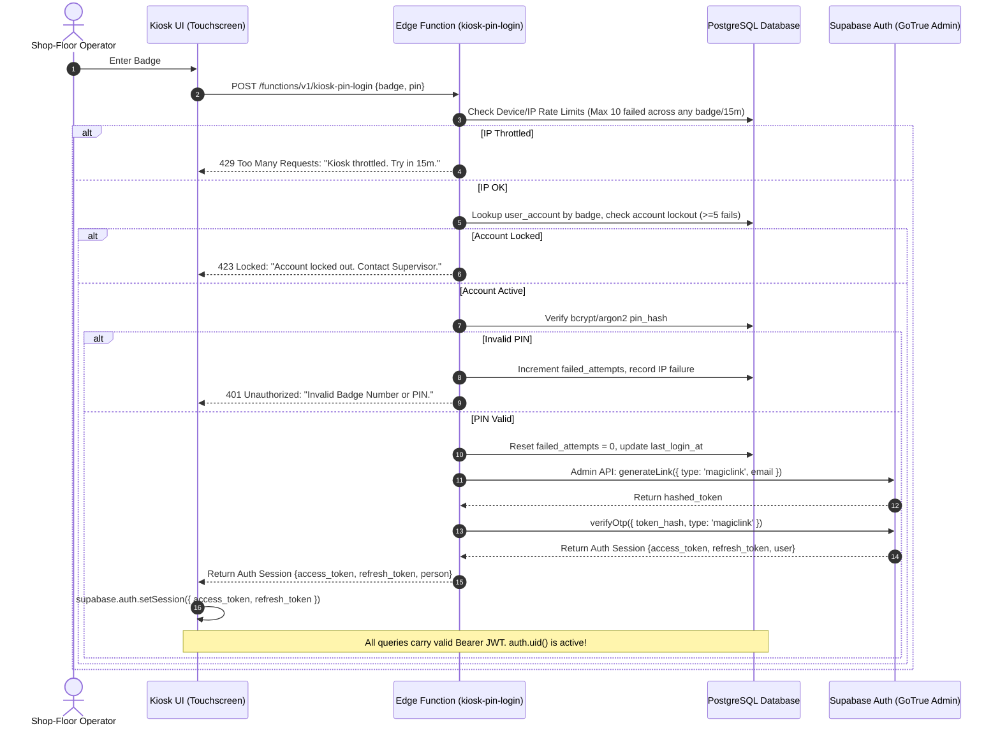
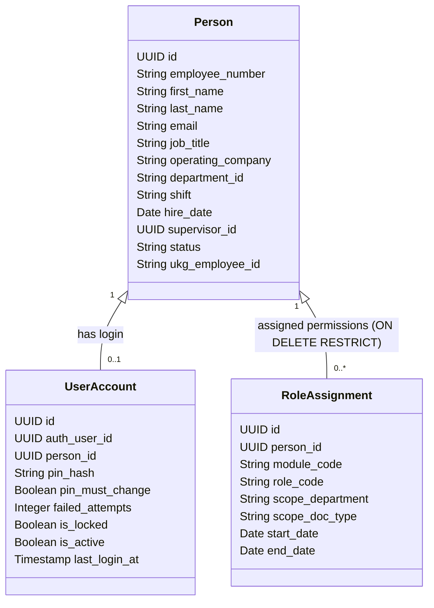

# Quality Compass // Shared User Management, Document Control & Training Requirements

**Document Title:** Unified User Management, Role-Based Access Control (RBAC), Document Control & Training Architecture  
**Author:** Quality Compass Engineering & Quality Architecture Team  
**System Pillar:** ISO 9001:2015 Clause 5.3 (Organizational Roles), Clause 7.2 (Competence), and Clause 7.5 (Documented Information)  
**Status:** Requirements & Technical Architecture Specification (Approved Design Baseline)  
**Date:** October 2026  
**Target Database:** QMS Core Supabase (`jggdqmygudsiueaiqzcn`)  

---

## Executive Summary

Quality Compass is evolving from an engineering CAD ballooning and QMS dashboard tool into an integrated Enterprise Quality Operating System across all four operating companies of **NHI Mechanical Motion LLC** (`NHI`, `TERRE`, `MANTIS`, `MAKERS`). 

Today, Quality Compass operates with zero true authentication and unvalidated free-text identity strings. In parallel, Phase 1 of the Shop-Floor Operator Training & Skills Qualification System was drafted with self-contained employee tables, mock user accounts, and local storage fallbacks. The Phase 1 database migration was never executed on Supabase.

This document defines the requirements, technical architecture, and migration roadmap to establish **ONE single, shared user management foundation** that:
1. **Unifies People and Accounts:** Tracks all personnel (including shop-floor operators without corporate email) under a single enterprise `public.people` directory (including job titles and supervisor links), while cleanly attaching system logins (`public.user_accounts`) only to those who need system access.
2. **Issues Real Supabase Sessions for Floor Staff:** Authenticates machine operators and leads via Employee Badge Number + 4-digit PIN through a dedicated Supabase Edge Function using documented Supabase Auth Admin APIs. This issues an authentic Supabase Auth session token, allowing Row Level Security (RLS) to evaluate `auth.uid()` identically for floor and office staff. Kiosks are protected by per-account lockout, device/IP rate limiting, forced first-login PIN changes, and 5-minute inactivity auto-logout.
3. **Provides Granular Modular RBAC:** Grants permissions per module (`DOCUMENT_CONTROL`, `TRAINING`, `QMS_CORE`, `APQP_PPAP`, `CAD_INSPECTION`) with optional departmental and document-type scoping, governed by strict `ON DELETE RESTRICT` integrity.
4. **Upgrades Document Control:** Enforces strict check-out concurrency locks, default category routes (authors may add reviewers but not remove required ones), multi-company approver authority, atomic database approval functions (`public.approve_revision`), strict self-approval blocking in all cases, mandatory review stage completion checks, and ISO 9001:2015 compliant electronic signatures with job title capture and password/PIN re-authentication.
5. **Rebuilds Training Cleanly in a Dedicated Schema:** Deletes the unexecuted Phase 1 migration script, creates clean tables under a separate `training` schema (`training.equipment`, `training.modules`, `training.records`, `training.qualifications`), normalizes skill qualification levels to 1–3 (In training, Qualified, Trainer), calculates qualification status dynamically in a database view rather than storing it, and eliminates demo/seed migration in favor of a clean roster CSV import.
6. **Enforces Security at the Database Layer:** Replaces client-side checks with PostgreSQL Row Level Security (RLS) across all existing and new Quality Compass tables, driven by security-definer helper functions with secured search paths (`SET search_path = public, pg_temp;`).
7. **Phased Implementation Roadmap:** Sequences development into three distinct steps:
   - **Step 2A:** Security Foundation, User Accounts, Real Login (Email + PIN Edge Function), RLS on all tables, Roster CSV import, and Admin screens.
   - **Step 2B:** Training Module rebuild in `training.*` schema using `public.people`, preserving existing 48px touch-target screen designs.
   - **Step 2C:** Document Control upgrade (locks, routing, signatures, lifecycle, watermarks, read-and-acknowledge bridge).

---

## Table of Contents

- [0. Training Phase 1 Build (Current Status & Clean Rebuild Scope)](#0-training-phase-1-build-current-status--clean-rebuild-scope)
  - [0.1 Where Phase 1 Lives & Execution Status](#01-where-phase-1-lives--execution-status)
  - [0.2 Phase 1 Inventory & Retirement Plan](#02-phase-1-inventory--retirement-plan)
  - [0.3 Data Audit: Zero Live Data & Clean Slate Plan](#03-data-audit-zero-live-data--clean-slate-plan)
  - [0.4 Clean Rebuild into the `training` Schema](#04-clean-rebuild-into-the-training-schema)
- [1. Current State Assessment of Quality Compass](#1-current-state-assessment-of-quality-compass)
  - [1.1 How Login Operates Today](#11-how-login-operates-today)
  - [1.2 Existing Database Tables & User References](#12-existing-database-tables--user-references)
  - [1.3 Hardcoded User Personas & Credentials to Purge](#13-hardcoded-user-personas--credentials-to-purge)
  - [1.4 Gaps, Inconsistencies & Compliance Risks](#14-gaps-inconsistencies--compliance-risks)
  - [1.5 Integration Inventory & RLS Impact Analysis](#15-integration-inventory--rls-impact-analysis)
- [2. Document Control System (DCS) Needs](#2-document-control-system-dcs-needs)
  - [2.1 Document Control Roles & Responsibilities](#21-document-control-roles--responsibilities)
  - [2.2 Strict 6-Stage Document Lifecycle](#22-strict-6-stage-document-lifecycle)
  - [2.3 Check-Out / Check-In Concurrency Locks](#23-check-out--check-in-concurrency-locks)
  - [2.4 Default Category Routes & Author Reviewer Additions](#24-default-category-routes--author-reviewer-additions)
  - [2.5 Inviolable Non-Authorship & Multi-Company Approvers](#25-inviolable-non-authorship--multi-company-approvers)
  - [2.6 Atomic Database Approvals & Re-Authenticated Signatures](#26-atomic-database-approvals--re-authenticated-signatures)
  - [2.7 Departmental & Document-Type Scoping](#27-departmental--document-type-scoping)
  - [2.8 Immutable Audit Trail & Historical Versioning](#28-immutable-audit-trail--historical-versioning)
- [3. Training & Competency Module Needs](#3-training--competency-module-needs)
  - [3.1 Normalized 3-Level Skill Qualification Model](#31-normalized-3-level-skill-qualification-model)
  - [3.2 Dynamic Status Calculation (View-Based, Never Stored)](#32-dynamic-status-calculation-view-based-never-stored)
  - [3.3 Tracking Shop-Floor Personnel Without Logins](#33-tracking-shop-floor-personnel-without-logins)
  - [3.4 Kiosk Authentication: Badge + PIN with Real Supabase Session](#34-kiosk-authentication-badge--pin-with-real-supabase-session)
  - [3.5 PIN Lifecycle, Device Rate Limiting & Security Rules](#35-pin-lifecycle-device-rate-limiting--security-rules)
  - [3.6 Personnel Archiving & UKG Sync Readiness](#36-personnel-archiving--ukg-sync-readiness)
- [4. Cross-Module System Needs](#4-cross-module-system-needs)
  - [4.1 Unified Identity Architecture: One Person, One Login, Modular Roles](#41-unified-identity-architecture-one-person-one-login-modular-roles)
  - [4.2 Cross-Module Workflow: Document Release to Training Assignment](#42-cross-module-workflow-document-release-to-training-assignment)
  - [4.3 Enterprise Deactivation & Archiving Governance](#43-enterprise-deactivation--archiving-governance)
  - [4.4 Non-Technical HR & Quality Administration Screens](#44-non-technical-hr--quality-administration-screens)
  - [4.5 Deferred Integrations (Automated Email & UKG Live Sync)](#45-deferred-integrations-automated-email--ukg-live-sync)
- [5. Proposed Shared Architecture & Technical Design](#5-proposed-shared-architecture--technical-design)
  - [5.1 Plain-English Shared Data Model](#51-plain-english-shared-data-model)
  - [5.2 Role-Permission Matrices by Module](#52-role-permission-matrices-by-module)
  - [5.3 Database-Enforced Row Level Security (RLS) Architecture](#53-database-enforced-row-level-security-rls-architecture)
  - [5.4 Re-Sequenced Implementation Roadmap (Steps 2A, 2B, 2C)](#54-re-sequenced-implementation-roadmap-steps-2a-2b-2c)
  - [5.5 Resolved Decisions Summary](#55-resolved-decisions-summary)

---

## 0. Training Phase 1 Build (Current Status & Clean Rebuild Scope)

### 0.1 Where Phase 1 Lives & Execution Status
The initial implementation of Phase 1 lives directly within the Quality Compass codebase (`src/components/training/`, `src/services/trainingService.ts`, and `supabase/migrations/20261012_phase1_training_qualification_schema.sql`). 

- **Migration Status:** The migration file `20261012_phase1_training_qualification_schema.sql` was **never executed** against the live Supabase database (`jggdqmygudsiueaiqzcn`).
- **PostgREST Verification:** Direct REST queries to PostgREST confirm that all `training_*` tables return `404 Not Found` (`PGRST205: table not found in schema cache`).
- **Runtime Fallback:** The application has been running exclusively via browser `localStorage` (`qc_phase1_*`) and hard-coded mock arrays.

### 0.2 Phase 1 Inventory & Retirement Plan
The unexecuted migration script created 10 tables in the `public` schema alongside standalone employee and user tables:
1. `public.training_departments`
2. `public.training_employees` *(Redundant with enterprise people)*
3. `public.training_app_users` *(Redundant with enterprise user accounts)*
4. `public.training_equipment`
5. `public.training_modules`
6. `public.training_resources`
7. `public.training_records`
8. `public.training_equipment_qualifications`
9. `public.training_requirements`
10. `public.training_audit_log`

**Retirement & Cleanup Action:**
- The file `supabase/migrations/20261012_phase1_training_qualification_schema.sql` will be **deleted**.
- Because the migration was never executed in the database, no tables need to be dropped from remote PostgreSQL.
- No temporary database compatibility views (`CREATE VIEW public.training_employees ...`) will be created. A clean break avoids technical debt.
- In Step 2B, training tables will be created fresh inside a dedicated PostgreSQL schema (`training`).

### 0.3 Data Audit: Zero Live Data & Clean Slate Plan
- **Remote Database Audit:** Exactly **0 rows** of training data exist in Supabase.
- **Decision on Seed/Demo Data:** Seed data (the 10 mock employees, mock equipment, and demo users) will **NOT** be migrated into the shared enterprise tables.
- **Roster Ingestion:** Production personnel records will be populated cleanly in Step 2A by importing a verified personnel roster CSV provided by management.

### 0.4 Clean Rebuild into the `training` Schema
In Step 2B, the training engine will be constructed cleanly:
- All training domain tables will reside in `training.*` (`training.equipment`, `training.modules`, `training.resources`, `training.records`, `training.qualifications`, `training.requirements`, `training.acknowledgments`).
- All worker foreign keys (`employee_id`, `trainer_id`, `certified_by`) will point directly to `public.people(id)` (UUID).
- The existing 11 React UI components in `src/components/training/` will be preserved without altering visual designs, touch ergonomics, or workflows. Only their service layer data bindings will be updated to point to the shared client and `training.*` schema.

---

## 1. Current State Assessment of Quality Compass

### 1.1 How Login Operates Today
Across the existing Quality Compass codebase:
- **Supabase Auth API:** There are zero active calls to `supabase.auth.signInWithPassword`, `supabase.auth.signUp`, or session management.
- **Current Behavior:** Every user visiting the web URL has immediate, unauthenticated read and write access across all modules (CAD Inspection, QMS Executive, Audits, Management Reviews, CAPA 8D, and Document Control).
- **Client Execution:** All database queries run through `src/services/supabase.ts` using the public anon key (`sb_publishable_...`). All requests arrive at PostgreSQL under the `anon` database role.

### 1.2 Existing Database Tables & User References
The following table documents every existing table and column storing user identity across Quality Compass:

| Module / Area | File Path | Table / Object | Columns Storing Identity | Nature of Identity Data |
| :--- | :--- | :--- | :--- | :--- |
| **CAD & Inspection** | `src/services/supabase.ts`<br>`src/components/DrawingCanvas.tsx` | `public.drawings` | `drawn_by`<br>`checked_by`<br>`approved_by` | Plain text strings in title block. Unvalidated. |
| **China Metrology** | `src/services/supabase.ts`<br>`src/components/ChinaApprovalModal.tsx` | `public.china_approvals` | `inspector_name`<br>`inspector_name_zh`<br>`qa_manager_name` | Plain text strings typed into form fields. |
| **Audits** | `src/services/qmsSupabase.ts`<br>`src/components/qms/QmsAuditsManager.tsx` | `public.qms_audits`<br>`public.qms_audit_findings` | `lead_auditor`<br>`department` | Plain text names. Findings have no individual owner ID. |
| **Management Review** | `src/services/qmsSupabase.ts`<br>`src/components/qms/QmsManagementReview.tsx` | `public.qms_management_reviews`<br>`public.qms_review_actions` | `facilitator`<br>`attendees` (JSONB)<br>`owner`<br>`verified_by` | Plain text names. Attendees is an unvalidated JSON string array. |
| **CAPA & CI** | `src/services/qmsSupabase.ts`<br>`src/components/qms/QmsCapaCiManager.tsx` | `public.qms_capas`<br>`public.qms_continuous_improvements` | `owner`<br>`eight_d_data.d1_team` (JSONB)<br>`submitted_by` | Plain text strings. |
| **Document Control** | `src/services/qmsSupabase.ts`<br>`src/components/qms/QmsDocumentControl.tsx` | `public.qms_documents`<br>`public.qms_document_revisions` | `owner`<br>`approved_by`<br>`created_by`<br>`checked_out_by` | Plain text strings. Checkout is tracked in local React state. |
| **APQP & PPAP** | `src/services/apqpPpapSupabase.ts`<br>`src/components/apqp/ApqpPpapDashboard.tsx` | `public.apqp_projects` | `lead_engineer` | Plain text string. |

### 1.3 Hardcoded User Personas & Credentials to Purge
In Step 2A, all hardcoded personas and credentials will be completely purged from code:
- **`src/services/trainingService.ts`:**
  - Mock employee IDs (`emp-1015`, `emp-1022`, `emp-1034`, `emp-1041`, `emp-1055`, `emp-1068`, `emp-1070`, `emp-1082`, `emp-1090`, `emp-1002`).
  - Mock user accounts and default PINs (`1234`).
  - Hardcoded strings (`'Admin'`, `'User'`, `'System'`).
- **`src/components/training/TrainingLoginModal.tsx`:**
  - Hardcoded demo presets for Lisa Ray, Jack Miller, Marcus Vance, and Sarah Jenkins.
  - Pre-filled mock email (`l.ray@nhimm.com`) and mock password (`Quality2026!`).
- **`src/components/qms/QmsDocumentControl.tsx`:**
  - Hardcoded checkout holder (`'Current User (Author)'`) and default author (`'Author'`).

### 1.4 Gaps, Inconsistencies & Compliance Risks
1. **Unauthenticated Public Access:** Anyone with the web URL can insert, update, or overwrite records in PostgreSQL.
2. **Text-Based Signatures:** Approvals are captured as loose text strings. There is no proof of signer identity.
3. **Self-Approval Violation:** Authors can currently approve their own documents, violating ISO 9001 Clause 7.5 quality standards.
4. **Client-Side Concurrency:** Document checkout locks exist only in browser memory, allowing simultaneous overwrite collisions.
5. **No Database Authorization:** Tables lack user-aware Row Level Security policies.

### 1.5 Integration Inventory & RLS Impact Analysis
The following table catalogs every script, scheduled pipeline, and frontend service that accesses Supabase, detailing how each currently connects and how each will authenticate once Row Level Security (RLS) is activated:

| Integration / Service | File Path | Operations & Target Tables | Current Auth Method | Authentication Strategy Under RLS |
| :--- | :--- | :--- | :--- | :--- |
| **Odoo Quality Sync Pipeline** (Hourly Cron) | `scripts/sync_odoo_quality.py`<br>`.github/workflows/odoo_quality_sync.yml` | **Writes** to `odoo_quality_records`, `odoo_quality_ppm_metrics`, `odoo_quality_defect_pareto`, `odoo_quality_workcenters`, `odoo_quality_sync_logs` | Secret key via GitHub Actions (`SUPABASE_SERVICE_ROLE_KEY`) | **Unchanged.** The service role key bypasses RLS in PostgreSQL. Automated hourly pipeline continues uninterrupted. |
| **Odoo Telemetry Frontend Service** | `src/services/odooQualityService.ts` | **Reads** from `odoo_*` tables | Anon publishable key (`sb_publishable_...`) | **Supabase JWT Session.** Requests will carry the logged-in user's Bearer token. RLS policy `FOR SELECT TO authenticated USING (true)` permits all verified staff to view telemetry. |
| **Pulse ERP Client** | `src/services/odooSupabase.ts`<br>`src/services/odooService.ts` | **Reads** from second DB (`vrsbfjiafjrbwbyullkh`): `odoo_sale_orders`, `lines`, `bom_operations` | Dedicated read-only anon key to Pulse DB | **Unchanged.** Pulse ERP is an external read-only mirror with public read policies. |
| **CAD & Inspection Service** | `src/services/supabase.ts` | **Reads & Writes** to `drawings`, `dimension_balloons`, `inspection_control_items`, `china_approvals` | Anon publishable key | **Supabase JWT Session.** RLS policies verify `auth.uid()`, granting read access to all authenticated staff, and write access only to users with `INSPECTOR` or `ADMIN` roles in `CAD_INSPECTION`. |
| **QMS Core Service** | `src/services/qmsSupabase.ts` | **Reads & Writes** to `qms_audits`, `qms_audit_findings`, `qms_management_reviews`, `qms_review_actions`, `qms_capas`, `qms_continuous_improvements` | Anon publishable key | **Supabase JWT Session.** Evaluates `has_permission('QMS_CORE', ...)` for create/update operations. |
| **Document Control Service** | `src/services/qmsSupabase.ts`<br>`src/components/qms/QmsDocumentControl.tsx` | **Reads & Writes** to `qms_documents`, `qms_document_revisions`, `qms_document_locks` | Anon publishable key | **Supabase JWT Session.** Drafts restricted to authors, reviewers, and controllers. Final approvals routed strictly via `public.approve_revision(...)`. |
| **APQP & PPAP Service** | `src/services/apqpPpapSupabase.ts` | **Reads & Writes** to `apqp_projects`, `ppap_submissions` | Anon publishable key | **Supabase JWT Session.** Write access restricted to engineers with `APQP_PPAP` module roles. |
| **Training Service** | `src/services/trainingService.ts` | **Reads & Writes** to `training.*` schema tables | LocalStorage fallback / Anon key | **Supabase JWT Session.** Floor kiosks and office users authenticate via Supabase Auth session tokens, evaluating `has_permission('TRAINING', ...)` in RLS. |

---

## 2. Document Control System (DCS) Needs

### 2.1 Document Control Roles & Responsibilities

| Role Name | Scope of Authority | Permitted Actions | Prohibited Actions |
| :--- | :--- | :--- | :--- |
| **Viewer** | Enterprise-wide (Plant floor & Office) | View and download released (effective) controlled PDFs. Search active catalog. | Cannot view working drafts, check out files, or approve. |
| **Author** | Assigned Department(s) | Create working drafts, check out source files (`.docx`, `.xlsx`, `.dwg`), check in revisions, submit for review, add extra reviewers. | Cannot approve or release documents. Cannot remove required reviewers. Cannot force check-in. |
| **Reviewer** | Assigned per revision / workflow | Review assigned drafts, submit formal Review Endorsement or Rejection with comments. | Cannot release documents to production. Cannot approve own work. |
| **Approver** | Department Manager / QA Lead | Review completed drafts, execute formal Release Approval using digital signature + credential re-authentication. | **Strictly prohibited from approving documents they authored.** |
| **Document Controller** | Quality Assurance Administration | Full administrative oversight of DCS: manage document numbering, override stuck check-outs (with reason), declare obsolete. | Subject to immutable audit logging on all overrides. |
| **Admin** | System-wide / Module Admin | Configure document categories, default approval routing rules, role permissions, emergency restores. | All actions logged to immutable audit trail. |

### 2.2 Strict 6-Stage Document Lifecycle



1. **DRAFT (Working Sandbox):**
   - Visible only to the author (`owner_person_id`), assigned co-authors, and Document Controllers.
   - Author holds the check-out lock on the master native source file.
2. **IN REVIEW (Collaborative Peer Review):**
   - Source file is locked from editing while review is underway.
   - Assigned reviewers review the draft PDF and add formal endorsements or rejections.
   - If any reviewer rejects, the document returns to `DRAFT` with feedback recorded.
3. **APPROVED (Pre-Release Sign-Off):**
   - All assigned reviewers have endorsed the revision.
   - Designated approver signs off via atomic database function `public.approve_revision(...)`.
4. **RELEASED / EFFECTIVE (Active Production Record):**
   - The compiled PDF becomes the legally controlled production document.
   - Automatic watermark applied: *"CONTROLLED DOCUMENT — NHI MECHANICAL MOTION LLC"*.
   - Universally visible to all staff enterprise-wide across all plants and kiosks.
5. **SUPERSEDED (Archived Revision):**
   - Triggered automatically when a newer revision reaches `RELEASED`.
   - The prior revision transitions to `SUPERSEDED` with watermark: *"SUPERSEDED — FOR REFERENCE ONLY"*.
   - Never deleted; preserved permanently for ISO 9001 audit history.
6. **OBSOLETE (Decommissioned):**
   - For procedures permanently retired without replacement.
   - Requires Document Controller authorization with recorded justification.
   - Watermarked: *"OBSOLETE — DO NOT USE"*.

### 2.3 Check-Out / Check-In Concurrency Locks
- **Single-Editor Lock:** Stored in `public.qms_document_locks` (`document_id`, `locked_by_person_id`, `locked_at`). No other user can check out or submit revisions while active.
- **Lock Visibility:** Prominent card banner: *"Locked by [First Last] since [Date/Time]"*.
- **Check-In Mechanics:** Prompt for mandatory Change Summary, create incremented revision draft, and release lock.
- **Forced Override Governance:** Only a **Document Controller** or **Admin** can force check-in. System requires mandatory justification text (minimum 20 characters), logs an audit event, and clears the lock.

### 2.4 Default Category Routes & Author Reviewer Additions
- **Default Category Routing:** Every document category has a configured baseline route (e.g., all SOPs require Technical Lead Review $\rightarrow$ QA Approver).
- **Author Reviewer Additions:** When submitting a draft, the author **may add** additional named reviewers (e.g. cross-department specialists).
- **Integrity Rule:** Authors **cannot remove** any mandatory reviewers or approvers defined by the default category route.

### 2.5 Inviolable Non-Authorship & Multi-Company Approvers
- **Strict Self-Approval Blocking:** Under no circumstances may an author approve their own document (`author_person_id != approver_person_id`). This rule is enforced directly in PostgreSQL database functions and cannot be bypassed.
- **Multi-Company Approver Authority:** Quality Compass operates across four companies (`NHI`, `TERRE`, `MANTIS`, `MAKERS`). Any qualified person holding the `APPROVER` role for that document type/department may approve the document, regardless of their own primary operating company affiliation.

### 2.6 Atomic Database Approvals & Re-Authenticated Signatures
Approvals will not be executed via client-side `UPDATE` queries on tables. Instead, approvals must be executed through a single PostgreSQL database function:
- **Database Function: `public.approve_revision(...)`**:
  1. Validates that the revision is in `status = 'IN_REVIEW'`. Drafts that skipped review are explicitly rejected.
  2. Verifies that **every required review step** on that revision's route has been formally endorsed (`status = 'ENDORSED'`).
  3. Verifies that the caller is explicitly assigned as an approver on that revision's approval route.
  4. Validates that the caller holds the `APPROVER` role for the document's module, department, and category.
  5. Enforces non-authorship: verifies `revision.created_by_person_id != caller_person_id`.
  6. Verifies electronic credential re-authentication (validates password or PIN via secure helper).
  7. Captures `signer_title` from `public.people.job_title` (not shift or department).
  8. Records the electronic signature in `public.electronic_signatures`.
  9. Advances revision status to `RELEASED`, sets effective dates, archives previous revisions to `SUPERSEDED`, and triggers training acknowledgment tasks if configured.
- **ISO 9001 Document Control Signature Standard:** Captures signer `person_id`, legal name snapshot, job title, timestamp, signature meaning (`"Reviewed"`, `"Approved Release"`), and PDF checksum.

### 2.7 Departmental & Document-Type Scoping
- **Released PDFs:** Universally accessible to all authenticated staff enterprise-wide.
- **Working Drafts & Native Files:** Restricted to authors, assigned reviewers, and Document Controllers possessing matching department or category scope.

### 2.8 Immutable Audit Trail & Historical Versioning
- `public.qms_document_revisions` and `public.electronic_signatures` are strictly append-only.
- PostgreSQL database triggers block `UPDATE` and `DELETE` on signed revisions.

---

## 3. Training & Competency Module Needs

### 3.1 Normalized 3-Level Skill Qualification Model
To align with industrial shop-floor standards and avoid overcomplication, skill qualifications are normalized to **three levels only**:

| Level | Level Name | Status Meaning | Sign-Off Authority |
| :---: | :--- | :--- | :--- |
| **Level 1** | **In Training** | Trainee operating under direct supervision. Learning SOPs, safety protocol, and setup checks. | Area Supervisor or Lead |
| **Level 2** | **Qualified** | Independent operator verified for standard production running, routine quality inspection, and tool changeovers. | Area Supervisor |
| **Level 3** | **Trainer** | Expert setup specialist, troubleshooter, and designated trainer authorized to instruct and sign off other operators. | Certified Level 3 Trainer *(No Manager countersign required)* |

*Note: Former levels 0 (Unassigned) and 4 (Master) are eliminated. Operators with no training simply lack a qualification record for that asset.*

### 3.2 Dynamic Status Calculation (View-Based, Never Stored)
To eliminate data staleness and conflicting records, qualification status (`Current`, `Due soon`, `Expired`, `In training`) is **never stored as a table column**. 
- The base table `training.qualifications` stores only immutable historical facts: `level`, `certified_date`, `expiration_date`, and `certified_by_person_id`.
- A database view `training.v_operator_qualifications` evaluates compliance dynamically in real time:

```sql
CREATE OR REPLACE VIEW training.v_operator_qualifications AS
SELECT 
  q.id,
  q.employee_id,
  p.employee_number,
  p.first_name,
  p.last_name,
  q.equipment_id,
  e.code AS equipment_code,
  e.name AS equipment_name,
  q.level,
  CASE 
    WHEN q.level = 1 THEN 'Level 1 (In Training)'
    WHEN q.level = 2 THEN 'Level 2 (Qualified)'
    WHEN q.level = 3 THEN 'Level 3 (Trainer)'
  END AS level_label,
  q.certified_date,
  q.expiration_date,
  q.certified_by_person_id,
  CASE 
    WHEN q.level = 1 THEN 'IN_TRAINING'
    WHEN q.expiration_date < CURRENT_DATE THEN 'EXPIRED'
    WHEN q.expiration_date <= CURRENT_DATE + INTERVAL '30 days' THEN 'DUE_SOON'
    ELSE 'QUALIFIED'
  END AS status,
  CASE 
    WHEN q.level = 1 THEN 'In training'
    WHEN q.expiration_date < CURRENT_DATE THEN 'Expired'
    WHEN q.expiration_date <= CURRENT_DATE + INTERVAL '30 days' THEN 'Due soon'
    ELSE 'Current'
  END AS status_label,
  q.evaluation_notes,
  q.created_at
FROM training.qualifications q
JOIN public.people p ON q.employee_id = p.id
JOIN training.equipment e ON q.equipment_id = e.id;
```

### 3.3 Tracking Shop-Floor Personnel Without Logins
- Every worker is tracked as a first-class record in `public.people` (name, badge number, department, shift, hire date, job title).
- Supervisors and trainers can select any operator from the roster to record training or certify qualifications without requiring that operator to have an active software login account.

### 3.4 Kiosk Authentication: Badge + PIN with Real Supabase Session
Shop-floor machine operators receive a **genuine Supabase Auth session** when logging in on mounted kiosks, so that Row Level Security policies evaluate `auth.uid()` identically for floor and office staff:



### 3.5 PIN Lifecycle, Device Rate Limiting & Security Rules
1. **Documented Supabase Auth Session Minting:**
   - Every floor worker assigned a login has an associated internal user in `auth.users` with a standardized synthetic email: `badge.<badge_number>@kiosk.nhimm.internal` (or their company email if they possess one).
   - In the Edge Function (`/functions/v1/kiosk-pin-login`), after verifying the PIN, the service role client calls:
     ```ts
     const { data, error } = await supabaseAdmin.auth.admin.generateLink({
       type: 'magiclink',
       email: userAccount.email,
     });
     const session = await supabaseAdmin.auth.verifyOtp({
       token_hash: data.properties.hashed_token,
       type: 'magiclink',
     });
     ```
   - This returns an authentic Supabase Auth session token, allowing the kiosk client to call `supabase.auth.setSession(...)`.
2. **Device / IP Rate Limiting:**
   - Because badge numbers are sequential (e.g. 1001, 1002, 1003...), an attacker could attempt common PINs across multiple badges without hitting any single account's 5-attempt limit.
   - The Edge Function enforces **IP-level rate limiting**: more than **10 failed PIN attempts from the same IP address or device identifier within 15 minutes** immediately locks out that kiosk IP with an HTTP 429 response for 15 minutes.
3. **Account Lockout Protection:** After **5 consecutive failed attempts on an individual account**, the account is locked (`is_locked = TRUE`, `locked_at = NOW()`).
4. **PIN Provisioning & Forced First-Login Change:** Initial PINs are cryptographically random 4-digit numbers generated by HR/Supervisor. PINs are **never derived from SSN or badge numbers**. The account flag `pin_must_change = TRUE` forces the worker to choose a personal PIN upon first login.
5. **Reset Authority:** Only an authorized **Area Supervisor** or **HR Specialist** can unlock an account or issue a temporary PIN.
6. **Kiosk Inactivity Timeout:** Shared kiosk tablets automatically terminate the session and clear tokens after **5 minutes of inactivity**.

### 3.6 Personnel Archiving & UKG Sync Readiness
- **Soft-Archiving:** Resigned or transferred workers are marked `status = 'ARCHIVED'` with mandatory `archive_reason` and `archived_at`.
- **Permanent Compliance History:** Archiving revokes login access immediately, but preserves all historical training completions, machine certifications, and signatures permanently.
- **UKG Fields Prepared:** `public.people` includes `ukg_employee_id`, `ukg_sync_hash`, and `last_ukg_sync_at` to support future automated roster sync.

---

## 4. Cross-Module System Needs

### 4.1 Unified Identity Architecture: One Person, One Login, Modular Roles



- **Referential Integrity:** `user_role_assignments` uses `ON DELETE RESTRICT` (not `CASCADE`) to ensure role records cannot be accidentally deleted if referenced by audit history.

### 4.2 Cross-Module Workflow: Document Release to Training Assignment
- **Configurable Acknowledgment Window:** When an SOP or Work Instruction is released, the Document Controller can designate it as requiring training acknowledgment.
- **Default Window:** The compliance completion window defaults to **30 days**, and is configurable per document (e.g. 14 days for critical OSHA safety changes).
- **Automated Assignment:** The release transaction creates pending acknowledgment items in `training.acknowledgments` for all active operators assigned to the affected equipment or department.

### 4.3 Enterprise Deactivation & Archiving Governance
- Deactivating a person immediately disables their login across all modules (`user_accounts.is_active = FALSE`).
- Active check-out locks held by that person are flagged for Document Controller reassignment.
- Pending approval steps trigger notification for administrative rerouting.
- Historical records retain their permanent foreign key links to `public.people(id)`.

### 4.4 Non-Technical HR & Quality Administration Screens
Administrative UI designed for HR coordinators and Quality Managers:
1. **People Directory:** Add, edit, soft-archive, and restore personnel. Search by badge, company, department, or shift.
2. **Account & Access Hub:** Toggle login access on/off, assign office email credentials, or generate/reset floor PINs.
3. **Modular Role Assignment Matrix:** Assign or revoke roles per module with department and document-type scoping.
4. **Unified User Dossier ("What can this person do?"):** Single-page view listing all system permissions held by a selected individual across all modules.

### 4.5 Deferred Integrations (Automated Email & UKG Live Sync)
- **Automatic Email Notifications:** Deferred. In-app notification badges and pending action queues will guide users.
- **UKG Live Sync:** Deferred. Roster sync will initially run via CSV import in Step 2A. Database fields for UKG integration are pre-wired.

---

## 5. Proposed Shared Architecture & Technical Design

### 5.1 Plain-English Shared Data Model

```
┌────────────────────────────────────────────────────────────────────────┐
│                        PUBLIC SCHEMA (Core Enterprise)                 │
├────────────────────────────────────────────────────────────────────────┤
│  • public.people                    (Master Human Directory)           │
│  • public.user_accounts             (Login, Auth UUID, PIN Hash)       │
│  • public.app_modules               (Modules: DOCS, TRAINING, etc.)    │
│  • public.module_roles              (Role Definitions per Module)      │
│  • public.user_role_assignments     (Person + Module + Role + Scope)   │
│  • public.electronic_signatures     (ISO 9001 Signature Archive)       │
│  • public.system_audit_log          (Enterprise Immutable Audit Trail) │
│                                                                        │
│  • public.qms_documents             (Tier-1 Controlled PDFs)           │
│  • public.qms_document_revisions    (Revision History)                 │
│  • public.qms_document_locks        (Check-Out Concurrency Locks)      │
│  • public.qms_document_approvals    (Sequential/Parallel Route Steps)  │
├────────────────────────────────────────────────────────────────────────┤
│                        TRAINING SCHEMA (Shop-Floor Competency)         │
├────────────────────────────────────────────────────────────────────────┤
│  • training.equipment               (Work Centers & Machines)          │
│  • training.modules                 (Training Catalog & SOP Courses)   │
│  • training.resources               (Multimodal Attachments)           │
│  • training.records                 (Completed Training Records)       │
│  • training.qualifications          (Machine Certifications L1, L2, L3)│
│  • training.v_operator_qualifications (Dynamic Real-Time Status View)  │
│  • training.requirements            (Mandatory Training Matrix)        │
│  • training.acknowledgments         (Document Release Training Tasks)  │
└────────────────────────────────────────────────────────────────────────┘
```

#### Detailed Table Specifications

##### 1. `public.people` (Master Personnel Directory)
- `id` (UUID, Primary Key, Default `gen_random_uuid()`).
- `employee_number` (TEXT, Unique, Not Null): Badge or payroll number.
- `first_name` (TEXT, Not Null) & `last_name` (TEXT, Not Null).
- `email` (TEXT, Nullable, Unique): Work email (nullable for floor staff without email).
- `job_title` (TEXT, Nullable): Formal job title (e.g. `'CNC Setup Machinist'`, `'Lead Quality Technician'`).
- `operating_company` (TEXT, Not Null): Partition code (`'NHI'`, `'TERRE'`, `'MANTIS'`, `'MAKERS'`).
- `department_id` (TEXT, Not Null).
- `shift` (TEXT, Default `'Shift 1 (Day)'`).
- `hire_date` (DATE, Default `CURRENT_DATE`).
- `supervisor_id` (UUID, Nullable, References `public.people(id)` ON DELETE SET NULL).
- `status` (TEXT, Default `'ACTIVE'`): `'ACTIVE'`, `'ARCHIVED'`.
- `archive_reason` (TEXT, Nullable).
- `archived_at` (TIMESTAMPTZ, Nullable).
- `ukg_employee_id` (TEXT, Nullable, Unique).
- `ukg_sync_hash` (TEXT, Nullable).
- `last_ukg_sync_at` (TIMESTAMPTZ, Nullable).
- `created_at` & `updated_at` (TIMESTAMPTZ, Default `NOW()`).

##### 2. `public.user_accounts` (System Login Credentials)
- `id` (UUID, Primary Key, Default `gen_random_uuid()`).
- `person_id` (UUID, Not Null, Unique, References `public.people(id)` ON DELETE RESTRICT).
- `auth_user_id` (UUID, Nullable, Unique, References `auth.users(id)` ON DELETE SET NULL).
- `pin_hash` (TEXT, Nullable): Salted hash of 4-digit PIN.
- `pin_must_change` (BOOLEAN, Default `FALSE`).
- `failed_attempts` (INTEGER, Default `0`).
- `is_locked` (BOOLEAN, Default `FALSE`).
- `locked_at` (TIMESTAMPTZ, Nullable).
- `is_active` (BOOLEAN, Default `TRUE`).
- `last_login_at` (TIMESTAMPTZ, Nullable).
- `created_at` & `updated_at` (TIMESTAMPTZ, Default `NOW()`).

##### 3. `public.user_role_assignments` (Modular RBAC)
- `id` (UUID, Primary Key, Default `gen_random_uuid()`).
- `person_id` (UUID, Not Null, References `public.people(id)` ON DELETE RESTRICT).
- `module_code` (TEXT, Not Null).
- `role_code` (TEXT, Not Null).
- `scope_department` (TEXT, Nullable).
- `scope_doc_type` (TEXT, Nullable).
- `start_date` (DATE, Default `CURRENT_DATE`).
- `end_date` (DATE, Nullable).
- `assigned_by` (UUID, References `public.people(id)` ON DELETE RESTRICT).
- `created_at` (TIMESTAMPTZ, Default `NOW()`).

##### 4. `public.qms_document_locks` (Check-Out Concurrency Locks)
- `document_id` (UUID, Primary Key, References `public.qms_documents(id)` ON DELETE CASCADE).
- `locked_by_person_id` (UUID, Not Null, References `public.people(id)` ON DELETE RESTRICT).
- `locked_at` (TIMESTAMPTZ, Not Null, Default `NOW()`).
- `source_file_name` (TEXT, Not Null).
- `override_reason` (TEXT, Nullable).
- `overridden_by_person_id` (UUID, Nullable, References `public.people(id)` ON DELETE RESTRICT).

##### 5. `public.electronic_signatures` (ISO 9001 Document Control Signatures)
- `id` (UUID, Primary Key, Default `gen_random_uuid()`).
- `person_id` (UUID, Not Null, References `public.people(id)` ON DELETE RESTRICT).
- `signer_name` (TEXT, Not Null).
- `signer_title` (TEXT, Not Null): Sourced from `public.people.job_title`.
- `meaning` (TEXT, Not Null): `'AUTHORED'`, `'REVIEWED'`, `'APPROVED_RELEASE'`, `'TRAINING_COMPLETED'`.
- `module_code` (TEXT, Not Null).
- `target_record_id` (TEXT, Not Null).
- `auth_method` (TEXT, Not Null): `'PASSWORD'` or `'PIN'`.
- `document_checksum` (TEXT, Nullable).
- `timestamp` (TIMESTAMPTZ, Not Null, Default `NOW()`).

##### 6. `training.qualifications` (Machine Qualifications L1–L3, No Stored Status)
- `id` (TEXT, Primary Key).
- `employee_id` (UUID, Not Null, References `public.people(id)` ON DELETE RESTRICT).
- `equipment_id` (TEXT, Not Null, References `training.equipment(id)` ON DELETE RESTRICT).
- `level` (INTEGER, Not Null CHECK (level IN (1, 2, 3))): 1=In Training, 2=Qualified, 3=Trainer.
- `certified_date` (DATE, Not Null).
- `expiration_date` (DATE, Not Null).
- `certified_by_person_id` (UUID, Not Null, References `public.people(id)` ON DELETE RESTRICT).
- `evaluation_notes` (TEXT, Nullable).
- `checklist_answers` (JSONB, Nullable).
- `created_at` (TIMESTAMPTZ, Default `NOW()`).
*(Note: Status is calculated on the fly in `training.v_operator_qualifications`).*

---

### 5.2 Role-Permission Matrices by Module

#### Module 1: Document Control System (`DOCUMENT_CONTROL`)

| Action / Capability | Viewer | Author | Reviewer | Approver | Document Controller | Module Admin |
| :--- | :---: | :---: | :---: | :---: | :---: | :---: |
| Search & View Released PDFs | ✅ | ✅ | ✅ | ✅ | ✅ | ✅ |
| Download Native Source File (.docx/.xlsx) | ❌ | ✅ (Owned/Scoped) | ✅ (Assigned) | ✅ | ✅ | ✅ |
| Create New Working Draft | ❌ | ✅ | ❌ | ❌ | ✅ | ✅ |
| Check Out / Lock Document | ❌ | ✅ | ❌ | ❌ | ✅ | ✅ |
| Check In New Revision Draft | ❌ | ✅ (Lock Holder) | ❌ | ❌ | ✅ | ✅ |
| Force Release Check-Out Lock | ❌ | ❌ | ❌ | ❌ | ✅ (With Reason) | ✅ |
| Submit Draft for Formal Review | ❌ | ✅ | ❌ | ❌ | ✅ | ✅ |
| Add Extra Reviewers to Route | ❌ | ✅ | ❌ | ❌ | ✅ | ✅ |
| Remove Required Category Reviewers | ❌ | ❌ | ❌ | ❌ | ❌ | ❌ |
| Endorse / Reject Review Stage | ❌ | ❌ | ✅ (Assigned) | ✅ | ✅ | ✅ |
| **Final Release Approval (Sign-Off)** | ❌ | ❌ | ❌ | **✅ (Any Company)** | **✅ (Any Company)** | ✅ |
| **Approve Own Authored Document** | **❌ BLOCKED** | **❌ BLOCKED** | **❌ BLOCKED** | **❌ BLOCKED** | **❌ BLOCKED** | **❌ BLOCKED** |
| Declare Document Obsolete | ❌ | ❌ | ❌ | ❌ | ✅ | ✅ |

#### Module 2: Shop-Floor Training & Qualifications (`TRAINING`)

| Action / Capability | Employee | Supervisor | Trainer (L3) | HR Specialist | Plant Manager | Training Admin |
| :--- | :---: | :---: | :---: | :---: | :---: | :---: |
| View Own Training Dossier | ✅ | ✅ | ✅ | ✅ | ✅ | ✅ |
| Access Standard Work SOP Guides | ✅ | ✅ | ✅ | ✅ | ✅ | ✅ |
| Sign Own Training Acknowledgment (PIN) | ✅ | ✅ | ✅ | ✅ | ✅ | ✅ |
| View Department Skills Matrix | ❌ | ✅ (Dept Scope) | ✅ | ✅ | ✅ (All Depts) | ✅ |
| Sign Off Level 1 (In Training) | ❌ | ✅ | ✅ | ❌ | ❌ | ✅ |
| Sign Off Level 2 (Qualified Operator) | ❌ | ✅ | ✅ | ❌ | ❌ | ✅ |
| **Sign Off Level 3 (Trainer)** | ❌ | ❌ | **✅ (No Mgr Countersign)** | ❌ | ❌ | ✅ |
| Manage Equipment / Work Centers | ❌ | ❌ | ❌ | ❌ | ❌ | ✅ |
| Manage Training Catalog & SOP Links | ❌ | ❌ | ❌ | ❌ | ❌ | ✅ |
| Reset Operator PIN | ❌ | ✅ | ❌ | ✅ | ❌ | ✅ |
| Soft-Archive / Restore Employee | ❌ | ❌ | ❌ | ✅ | ❌ | ✅ |
| Export Audit Compliance ZIP Backup | ❌ | ❌ | ❌ | ✅ | ✅ | ✅ |

---

### 5.3 Database-Enforced Row Level Security (RLS) Architecture

#### 1. Core Helper: `public.current_person_id()` (Secured Search Path)
```sql
CREATE OR REPLACE FUNCTION public.current_person_id()
RETURNS UUID AS $$
  SELECT person_id 
  FROM public.user_accounts 
  WHERE auth_user_id = auth.uid() 
    AND is_active = TRUE
  LIMIT 1;
$$ LANGUAGE sql STABLE SECURITY DEFINER
SET search_path = public, pg_temp;
```

#### 2. Core Helper: `public.has_permission()` (Per-Module Admin Scoping)
```sql
CREATE OR REPLACE FUNCTION public.has_permission(
  p_module_code TEXT,
  p_required_role TEXT,
  p_department TEXT DEFAULT NULL,
  p_doc_type TEXT DEFAULT NULL
)
RETURNS BOOLEAN AS $$
BEGIN
  -- 1. Check Module-Specific Admin or dedicated SYSTEM_ADMIN
  IF EXISTS (
    SELECT 1 FROM public.user_role_assignments ura
    WHERE ura.person_id = public.current_person_id()
      AND (
        (ura.module_code = p_module_code AND ura.role_code = 'ADMIN')
        OR ura.role_code = 'SYSTEM_ADMIN'
      )
      AND (ura.end_date IS NULL OR ura.end_date >= CURRENT_DATE)
  ) THEN
    RETURN TRUE;
  END IF;

  -- 2. Check specific modular role and scope
  RETURN EXISTS (
    SELECT 1 FROM public.user_role_assignments ura
    WHERE ura.person_id = public.current_person_id()
      AND ura.module_code = p_module_code
      AND ura.role_code = p_required_role
      AND (ura.scope_department IS NULL OR ura.scope_department = p_department)
      AND (ura.scope_doc_type IS NULL OR ura.scope_doc_type = p_doc_type)
      AND (ura.start_date <= CURRENT_DATE)
      AND (ura.end_date IS NULL OR ura.end_date >= CURRENT_DATE)
  );
END;
$$ LANGUAGE plpgsql STABLE SECURITY DEFINER
SET search_path = public, pg_temp;
```

#### 3. Corrected Draft Visibility RLS Policy
Compares Person UUIDs correctly across documents, revisions, and approval steps:
```sql
CREATE POLICY "Control draft vs released document visibility"
ON public.qms_documents
FOR SELECT
USING (
  -- Released and historical versions visible to all authenticated staff
  status IN ('RELEASED', 'APPROVED', 'SUPERSEDED')
  -- Document Controllers and Admins can view all drafts
  OR public.has_permission('DOCUMENT_CONTROL', 'DOCUMENT_CONTROLLER')
  -- Authors can view their own drafts
  OR owner_person_id = public.current_person_id()
  -- Assigned reviewers can view drafts they are routed to evaluate
  OR EXISTS (
    SELECT 1 
    FROM public.qms_document_approval_steps das
    JOIN public.qms_document_revisions dr ON das.revision_id = dr.id
    WHERE dr.document_id = qms_documents.id
      AND das.assigned_person_id = public.current_person_id()
  )
);
```

#### 4. Atomic Database Approval Function (`public.approve_revision`)
Replaces client-side `UPDATE` statements to strictly guarantee non-authorship, required review stage completion, assigned approver validation, role authorization, and credential re-authentication in one atomic transaction:
```sql
CREATE OR REPLACE FUNCTION public.approve_revision(
  p_revision_id UUID,
  p_auth_method TEXT,
  p_credential TEXT,
  p_decision_notes TEXT DEFAULT NULL
)
RETURNS JSONB AS $$
DECLARE
  v_caller_person_id UUID;
  v_doc_id UUID;
  v_doc_dept TEXT;
  v_doc_cat TEXT;
  v_rev_status TEXT;
  v_author_person_id UUID;
  v_sig_id UUID;
  v_pending_reviews INTEGER;
BEGIN
  -- 1. Identify Caller
  v_caller_person_id := public.current_person_id();
  IF v_caller_person_id IS NULL THEN
    RAISE EXCEPTION 'AUTHENTICATION_REQUIRED: Caller is not a valid user.';
  END IF;

  -- 2. Fetch Revision and Parent Document Information
  SELECT dr.document_id, dr.status, dr.created_by_person_id, qd.department, qd.category
  INTO v_doc_id, v_rev_status, v_author_person_id, v_doc_dept, v_doc_cat
  FROM public.qms_document_revisions dr
  JOIN public.qms_documents qd ON dr.document_id = qd.id
  WHERE dr.id = p_revision_id;

  IF NOT FOUND THEN
    RAISE EXCEPTION 'NOT_FOUND: Revision does not exist.';
  END IF;

  -- 3. Verify Revision Status (Must be IN_REVIEW; Drafts skipping review are rejected)
  IF v_rev_status != 'IN_REVIEW' THEN
    RAISE EXCEPTION 'WORKFLOW_VIOLATION: Revision must be in IN_REVIEW status to be approved. Current status: %', v_rev_status;
  END IF;

  -- 4. Verify Every Required Review Step Has Been Endorsed
  SELECT COUNT(*)
  INTO v_pending_reviews
  FROM public.qms_document_approval_steps das
  WHERE das.revision_id = p_revision_id
    AND das.step_type = 'REVIEW'
    AND das.is_required = TRUE
    AND das.status != 'ENDORSED';

  IF v_pending_reviews > 0 THEN
    RAISE EXCEPTION 'WORKFLOW_VIOLATION: Cannot approve revision. % required review steps are still pending or rejected.', v_pending_reviews;
  END IF;

  -- 5. Verify Caller is an Assigned Approver on this Revision's Route
  IF NOT EXISTS (
    SELECT 1 FROM public.qms_document_approval_steps das
    WHERE das.revision_id = p_revision_id
      AND das.step_type = 'APPROVAL'
      AND das.assigned_person_id = v_caller_person_id
  ) THEN
    RAISE EXCEPTION 'UNAUTHORIZED: Caller is not an assigned approver on this revision route.';
  END IF;

  -- 6. Strict Self-Approval Block (Inviolable across all companies)
  IF v_author_person_id = v_caller_person_id THEN
    RAISE EXCEPTION 'SEGREGATION_OF_DUTIES_VIOLATION: Authors are strictly forbidden from approving their own documents.';
  END IF;

  -- 7. Check Approver Permission (Multi-Company authority respected)
  IF NOT public.has_permission('DOCUMENT_CONTROL', 'APPROVER', v_doc_dept, v_doc_cat) THEN
    RAISE EXCEPTION 'UNAUTHORIZED: Caller does not possess APPROVER role for this department and category.';
  END IF;

  -- 8. Verify Credential Re-Authentication (Password or PIN)
  IF NOT public.verify_user_credential(v_caller_person_id, p_auth_method, p_credential) THEN
    RAISE EXCEPTION 'INVALID_CREDENTIAL: Signature re-authentication failed.';
  END IF;

  -- 9. Record ISO 9001 Electronic Signature with job_title
  INSERT INTO public.electronic_signatures (
    person_id, signer_name, signer_title, meaning, module_code, target_record_id, auth_method
  )
  SELECT 
    p.id, 
    p.first_name || ' ' || p.last_name, 
    COALESCE(p.job_title, 'Approver'), 
    'APPROVED_RELEASE', 
    'DOCUMENT_CONTROL', 
    p_revision_id::TEXT, 
    p_auth_method
  FROM public.people p WHERE p.id = v_caller_person_id
  RETURNING id INTO v_sig_id;

  -- 10. Update Approval Step Record
  UPDATE public.qms_document_approval_steps
  SET status = 'ENDORSED', decided_at = NOW(), decision_notes = p_decision_notes, signature_id = v_sig_id
  WHERE revision_id = p_revision_id AND assigned_person_id = v_caller_person_id AND step_type = 'APPROVAL';

  -- 11. Advance Status to RELEASED and Supersede Previous Revisions
  UPDATE public.qms_document_revisions 
  SET status = 'SUPERSEDED' 
  WHERE document_id = v_doc_id AND status = 'RELEASED';

  UPDATE public.qms_document_revisions 
  SET status = 'RELEASED', approved_at = NOW(), signature_id = v_sig_id 
  WHERE id = p_revision_id;

  UPDATE public.qms_documents 
  SET status = 'RELEASED', updated_at = NOW() 
  WHERE id = v_doc_id;

  RETURN jsonb_build_object('success', true, 'signature_id', v_sig_id);
END;
$$ LANGUAGE plpgsql SECURITY DEFINER
SET search_path = public, pg_temp;
```

---

### 5.4 Re-Sequenced Implementation Roadmap (Steps 2A, 2B, 2C)

#### Step 2A: Security Foundation (Sequential Build with Testing Stops)
Step 2A will be built on a new branch against the **DEV database only**, stopping for stakeholder testing after each lettered milestone:

- **2A.a — Tables and Helper Functions:**
  - Create `public.people` (with `job_title` and `supervisor_id`), `public.user_accounts`, `public.app_modules`, `public.module_roles`, `public.user_role_assignments` (`ON DELETE RESTRICT`), and audit triggers.
  - Deploy security helper functions: `current_person_id()`, `has_permission()` (module-scoped admin, `SET search_path`), and `verify_user_credential()`.
  - *Milestone Check:* Stop for database schema verification.
- **2A.b — Real Login & Kiosk Edge Function:**
  - Standard Supabase Auth (email/password) for office staff.
  - Edge Function `/functions/v1/kiosk-pin-login` for floor staff issuing authentic Supabase Auth session tokens.
  - Enforce forced first-login PIN changes, 5-attempt account lockout, per-device/IP rate limiting, and 5-minute kiosk inactivity logout.
  - Completely remove all demo logins, presets, and hard-coded credentials from codebase.
  - *Milestone Check:* Stop for office and kiosk authentication testing.
- **2A.c — Roster Import from Management CSV:**
  - Provide an interactive CSV import utility with preview and error reporting.
  - Mandatory CSV columns: `employee_number`, `first_name`, `last_name`, `email`, `job_title`, `operating_company`, `department`, `shift`, `hire_date`, `supervisor_employee_number`.
  - Ingest the official company roster cleanly into `public.people`.
  - *Milestone Check:* Stop for roster verification and data comparison report.
- **2A.d — Non-Technical Admin Screens:**
  - People directory (view, add, edit, soft-archive, restore).
  - Login access and PIN reset manager.
  - Modular role assignment per module.
  - Single-person dossier page ("What can this person do?").
  - *Milestone Check:* Stop for HR / Admin screen usability testing.
- **2A.e — Progressive Module-by-Module RLS Activation:**
  - Turn on RLS **ONE MODULE AT A TIME** in this exact order:
    1. CAD Inspection (`drawings`, `balloons`, `items`)
    2. China Metrology Approvals (`china_approvals`)
    3. QMS Audits & Findings (`qms_audits`, `qms_audit_findings`)
    4. Management Review (`qms_management_reviews`, `qms_review_actions`)
    5. CAPA & CI (`qms_capas`, `qms_continuous_improvements`)
    6. Document Control baseline (`qms_documents`, `qms_document_revisions`)
    7. APQP & PPAP Launch Hub (`apqp_projects`, `ppap_submissions`)
    8. Odoo Telemetry data (`odoo_*` tables)
  - For each module: write policies, log in as each role, verify correct read/write permissions, verify module screens function without regression, then advance to the next.
  - *Milestone Check:* Stop for module verification after each step.
- **2A.f — Automated Security Tests:**
  - Automated test suite logging in as each defined role to prove database-level access boundaries.
  - *Milestone Check:* Stop for final Step 2A approval.

*(Note: Step 2A does NOT build training tables, document locks, approval routing, signatures, or the "who can approve X" lookup. Those belong to Steps 2B and 2C).*

#### Step 2B: Training Rebuilt on `training` Schema
1. **Purge Unused Migration:** Delete `supabase/migrations/20261012_phase1_training_qualification_schema.sql`.
2. **Clean `training.*` Tables:** Deploy fresh schema `CREATE SCHEMA training;` with tables (`equipment`, `modules`, `resources`, `records`, `qualifications`, `requirements`, `acknowledgments`), foreign keys referencing `public.people(id)`, and skill levels normalized to 1–3.
3. **Deploy Dynamic Status View:** Create `training.v_operator_qualifications` calculating status dynamically.
4. **Service Layer Refactor:** Update `src/services/trainingService.ts` to query `training.*` schema with database RLS.
5. **Preserve UI Ergonomics:** Keep all 11 existing React screens in `src/components/training/` with their 48px touch targets, mobile-responsive layouts, and plain English vocabulary.

#### Step 2C: Document Control Upgrade
1. **Concurrency Locks:** Implement `public.qms_document_locks` with single-editor check-out and Document Controller force-release with mandatory audit reason.
2. **Category Routing:** Implement default category routes with author ability to add reviewers.
3. **Atomic Approval Function:** Deploy `public.approve_revision(...)` with mandatory review stage verification, non-authorship blocking, and multi-company approver support.
4. **Electronic Signatures & Lifecycle:** Deploy `public.electronic_signatures` (capturing `job_title`), enforce 6-stage lifecycle transitions, and automated watermarking.
5. **Read-and-Acknowledge Bridge:** Implement automatic assignment generation into `training.acknowledgments` upon document release (30-day default window, configurable per document).
6. **Reverse Lookup Screen:** Deploy the "Who can approve X" reverse permission query tool.

---

## 5.5 Resolved Decisions Summary

| # | Topic / Question | Business Decision & Architecture Impact |
| :---: | :--- | :--- |
| **1** | **Seed & Demo Data** | **Do not migrate.** Delete unexecuted Phase 1 migration. Recreate training tables fresh in `training` schema. Real roster populated from management CSV. |
| **2** | **Compliance Reference** | **Remove 21 CFR Part 11 references.** Frame as ISO 9001:2015 Clause 7.5 Document Control with re-authenticated electronic signatures. |
| **3** | **Qualification Levels** | **Levels 1–3 only:** Level 1 (In training), Level 2 (Qualified), Level 3 (Trainer). Former levels 0 and 4 eliminated. Status calculated dynamically in view. |
| **4** | **PIN Security Rules** | Random PIN generated by HR/system, forced change on first login, never derived from SSN/badge, 5-attempt lockout, reset by Supervisor/HR, 5-minute kiosk inactivity logout. |
| **5** | **Self-Approval Rule** | **Strictly blocked in all cases.** Approvers from any NHIMM operating company may approve if they hold the `APPROVER` role. |
| **6** | **Approval Routing** | Default route defined per document category. Authors may add extra reviewers, but cannot remove required baseline reviewers. All required reviews must be endorsed before approval. |
| **7** | **Read & Acknowledge** | **30-day default window**, configurable per document. |
| **8** | **Level 3 Endorsement** | **No Manager countersign required.** Certified Level 3 Trainer sign-off is legally sufficient. |
| **9** | **`has_permission()` Scope** | Module-scoped admin (or dedicated `SYSTEM_ADMIN`). All security definer functions include `SET search_path = public, pg_temp;`. |
| **10** | **Identity Matching** | All database policies and foreign keys compare `UUID` Person IDs, never names or employee numbers. |
| **11** | **Draft Visibility Policy** | Corrected to join `qms_document_approval_steps` through `qms_document_revisions` to `qms_documents.id`. |
| **12** | **Approval Execution** | Replaced table UPDATE policies with atomic `public.approve_revision(...)` database function capturing `job_title` and checking required reviews. |
| **13** | **Floor Kiosk Auth Session** | Edge Function (`kiosk-pin-login`) uses Supabase Auth Admin API (`generateLink` + `verifyOtp`) to issue real JWT session tokens, with IP-level rate limiting (max 10 fails/15m). |
| **14** | **Role Assignment Integrity** | `public.user_role_assignments` uses `ON DELETE RESTRICT` (not `CASCADE`). |
| **15** | **Integrations Under RLS** | Background pipelines (`sync_odoo_quality.py`) use `SUPABASE_SERVICE_ROLE_KEY` to bypass RLS. Frontend services authenticate via Supabase session JWT. |

---

*End of Approved Requirements Specification — Ready for Step 2A Implementation upon approval.*
