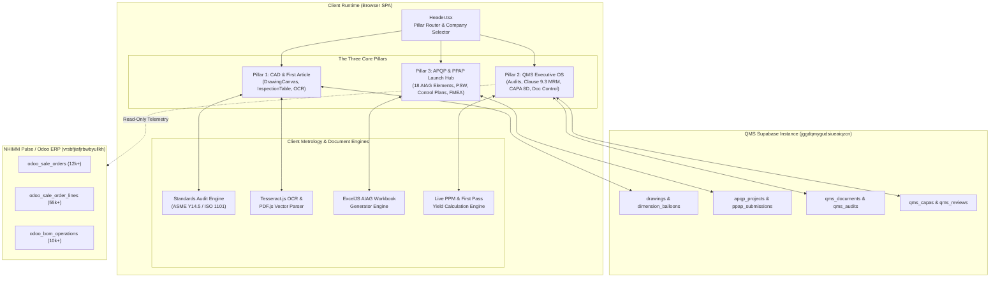

# Architecture and Data Flow

This document details the software architecture, state lifecycle, and cross-system data pipeline powering **Quality Compass**.

---

## 1. High-Level System Architecture

Quality Compass is a single-page application (SPA) built with React 19, TypeScript, and Vite 8. It interfaces directly with cloud databases, metrology engines, and document compilation services in the browser:

---

## 2. Navigation Routing & Mode Management

Navigation is driven by the state variables `activeViewMode` in `src/App.tsx`, controlled via `src/components/Header.tsx`:

- `'INSPECTION'`: Renders `DrawingCanvas.tsx` alongside `InspectionTable.tsx`. Used by Quality Engineers, CMM operators, and China QC teams to balloon prints, verify GD&T callouts, select inspection tools, and generate first-article inspection reports.
- `'QMS_DASHBOARD'`: Renders `QmsDashboard.tsx`. Organizes quality governance into sub-tabs:
  - `OVERVIEW`: Executive cockpit with top-line KPIs, open CAPAs, audit statuses, and PPM badge.
  - `AUDITS`: Internal, Registrar (TÜV), Customer, and Regulatory audit management.
  - `MANAGEMENT_REVIEW`: ISO 9001:2015 Clause 9.3 agenda builder with live system tie-ins.
  - `CAPA_CI`: 8D problem-solving lifecycle and continuous improvement suggestions.
  - `QUALITY_METRICS`: Shopfloor PPM telemetry, FPY %, Pareto analysis, and workcenter scrap.
  - `DOCUMENT_CONTROL`: 3-Tier document control (Approved PDFs, Source Vault, Working Documents).
  - `ODOO_CONFIG`: ERP sync parameters and connection status.
- `'APQP_PPAP'`: Renders `ApqpPpapDashboard.tsx`. Guides product development teams through the 5 APQP phases, AIAG 18-element checklists, PSW generation, FMEAs, Control Plans, and Run-at-Rate capacity studies.

---

## 3. Dual-Supabase Database Topology

Quality Compass connects to two distinct, isolated Supabase backends. Each client is configured with its own URL, publishable key, and specific domain role.

### A. QMS Core Database
- **URL:** `https://jggdqmygudsiueaiqzcn.supabase.co`
- **Environment Variable:** `VITE_SUPABASE_URL` / `VITE_SUPABASE_ANON_KEY`
- **Client Service:** `src/services/supabase.ts`
- **Data Responsibility:**
  - CAD Drawings & Revisions (`drawings`, `drawing_revisions`)
  - Dimension Balloons & Tolerances (`dimension_balloons`)
  - Metrology Control Items (`inspection_control_items`)
  - China QC Inspection Approvals (`china_approvals`)
  - Document Control & Vault (`qms_documents`, `qms_document_revisions`)
  - Quality Audits & Findings (`qms_audits`, `qms_audit_findings`)
  - Management Reviews & Actions (`qms_management_reviews`, `qms_review_actions`)
  - CAPA 8D & Kaizen Suggestions (`qms_capas`, `qms_continuous_improvements`)
  - APQP Projects & Submissions (`apqp_projects`, `ppap_submissions`, `ppap_document_attachments`)

### B. NHIMM Pulse / Odoo ERP Database
- **URL:** `https://vrsbfjiafjrbwbyullkh.supabase.co`
- **Environment Variable:** `VITE_ODOO_SUPABASE_URL` / `VITE_ODOO_SUPABASE_ANON_KEY`
- **Client Service:** `src/services/odooSupabase.ts`
- **Data Responsibility:**
  - Read-only operational replica of Odoo ERP.
  - Sales Orders (`odoo_sale_orders`) — over 12,000 active and historical customer orders.
  - Sales Order Lines (`odoo_sale_order_lines`) — over 55,000 line items used for customer part lookups, customer selection, and demand planning.
  - BOM Routing & Work Centers (`odoo_bom_operations`) — over 10,000 operations used to map part numbers to plant machines, cycle times, and routing steps.

---

## 4. Offline Fallback & Resilience Strategy

To ensure uninterrupted shopfloor operation during network drops or in environments without active Supabase credentials:

1. **Drawings & Balloons:** When Supabase is unreachable, the system falls back to `PRELOADED_DRAWINGS` in `src/data/sampleDrawings.ts`. User additions are temporarily held in component state or local storage.
2. **QMS Audits & CAPAs:** If Supabase queries fail, `qmsSupabase.ts` catches the error and returns seed data representing active NHIMM audits (e.g., TÜV Registrar audit, Tesla Customer Audit) and active 8Ds.
3. **APQP & PPAP:** If `apqp_projects` cannot be fetched from Supabase, `apqpPpapSupabase.ts` initializes default sample projects mapped to standard part numbers (e.g., Mantis Heavy-Duty Pulley, Terre Ductile Iron Hub).
4. **Odoo ERP Autocomplete:** If the NHIMM Pulse database is disconnected, `src/services/odooSupabase.ts` uses internal fallback customer arrays and sample part catalogs so that dropdowns never lock up.

---

## 5. In-Memory Caching & Performance

To deliver instant UI responsiveness across large datasets:

- **Customer Autocomplete Cache:** `fetchOdooCustomers()` caches distinct customer names extracted from 55,000+ line items in memory with a 5-minute Time-To-Live (TTL).
- **Part SKU & BOM Operations Cache:** Products and BOM routing steps are indexed in client-side HashMaps for sub-millisecond autocomplete lookups during APQP project creation.
- **Optimistic State Updates:** When users update an audit finding, advance an 8D step, or verify a management review action, the UI state updates immediately while the asynchronous Supabase mutation executes in the background. If the remote write fails, an error toast is displayed and state rolls back.
