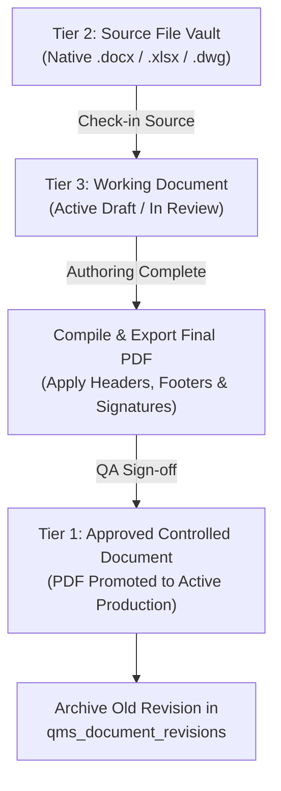

# 3-Tier Document Control System

This document specifies the consensus-driven document control architecture, file classification rules, revision lifecycles, and promotion workflows of the **Document Control System (DCS)** in Quality Compass.

---

## 1. Executive Consensus & Guiding Principles

During platform design, a strict operational consensus was established:

> [!IMPORTANT]
> **Approved PDFs Are the Only Controlled Documents.**  
> Editable formats (`.docx`, `.xlsx`, `.dwg`, `.pptx`) can easily be modified on client machines without leaving an audit trail. To satisfy ISO 9001:2015 Clause 7.5 (Documented Information) and Tier-1 customer audits, released controlled documents must be read-only, signed, watermarked **PDF files**.

To support active engineering authoring while guaranteeing regulatory compliance, Quality Compass implements a **3-Tier Document Control Architecture**:

```
┌────────────────────────────────────────────────────────────────────────┐
│               The 3-Tier Document Control Architecture                 │
├────────────────────────────────────────────────────────────────────────┤
│  TIER 1: Approved Controlled Documents                                 │
│  • Strictly PDF format only                                            │
│  • Official legally auditable release record                           │
│  • Immutable revision history, effective dates & watermarking          │
├────────────────────────────────────────────────────────────────────────┤
│  TIER 2: Source File Vault                                             │
│  • Native editable files (.docx, .xlsx, .dwg, .pptx)                   │
│  • Linked to parent Tier-1 document record                             │
│  • Check-out / check-in reservation tracking                           │
├────────────────────────────────────────────────────────────────────────┤
│  TIER 3: Isolated Working Documents (Draft Sandbox)                    │
│  • Staging area for active authoring, peer reviews & redlines          │
│  • Isolated from plant floor views until compiled to PDF and promoted  │
└────────────────────────────────────────────────────────────────────────┘
```

Component: `src/components/qms/QmsDocumentControl.tsx`  
Storage Service: `src/services/qmsStorageService.ts`  
Types: `src/types/qms.ts` (`ControlledDocument`, `SourceVaultItem`, `WorkingDocument`)  
Supabase Tables: `qms_documents`, `qms_document_revisions`  
Supabase Storage Bucket: `qms-documents` (`vault/`, `working/`, `controlled/` paths with IndexedDB offline fallback)

---

## 2. Tier 1: Approved Controlled Documents

Tier 1 houses the official, active procedures, work instructions, and forms in production:

### Mandatory Controlled Document Attributes:
- **Document Number:** Unique standard code (e.g., `SOP-QA-001`, `WI-MANTIS-012`, `FORM-APQP-04`).
- **Document Title:** Formal descriptive title.
- **Category:** `Quality Manual`, `SOP`, `Work Instruction`, `Inspection Procedure`, or `Form/Template`.
- **Department:** `Quality Assurance`, `Machining`, `Assembly`, `Supply Chain`, `Engineering`, or `Executive`.
- **Current Revision:** Formal alphanumeric revision code (`Rev A`, `Rev B`, `Rev 01`).
- **Approval Metadata:** `approved_by` (QA Manager / Executive) and `approved_at` timestamp.
- **PDF Asset Association:** Direct link to read-only PDF file (`pdf_file_url`, `pdf_file_name`, `pdf_file_size_bytes`).
- **Watermark & Compliance Notice:**
  - Watermark: *"CONTROLLED DOCUMENT — NHI MECHANICAL MOTION LLC"*
  - Uncontrolled Copy Notice: *"UNCONTROLLED IF PRINTED OR DOWNLOADED. VERIFY CURRENT REVISION IN QUALITY COMPASS DCS."*
- **Review Lifecycle:** Tracks `effective_date` and `next_review_date` (annual review cadence).

---

## 3. Tier 2: Native Source File Vault

Tier 2 serves as the secure digital repository for native, editable authoring assets:
- **Supported Native Types:** Microsoft Word (`.docx`), Microsoft Excel (`.xlsx`), AutoCAD Drawing (`.dwg`), Microsoft PowerPoint (`.pptx`).
- **Parent Linkage:** Every vault item references a primary `document_id` and `doc_number`.
- **Check-Out Governance:**
  - When an engineer checks out a source file for revision, `is_checked_out` is set to `true` and `checked_out_by` records the engineer's username.
  - Prevents dual-author overwrite collisions during active engineering changes.

---

## 4. Tier 3: Isolated Working Documents (Draft Sandbox) & Drag-and-Drop Intake

Tier 3 provides a collaborative staging workspace for documents undergoing active revision or initial drafting:
- **Stages:** `DRAFT` $\rightarrow$ `IN_REVIEW` $\rightarrow$ `PENDING_APPROVAL`.
- **Sandbox Isolation:** Working drafts are visible only inside the authoring tab and cannot be accessed from plant floor work stations or audit inspections until formally promoted.
- **Direct Drag-and-Drop Intake:**
  - Engineers can drag and drop native Word (`.docx`), Excel (`.xlsx`), AutoCAD (`.dwg`), PowerPoint (`.pptx`), or draft PDF files directly into the Tier 3 dropzone.
  - An intelligent regex parser automatically extracts procedure codes (e.g. `SOP-QMS-001`), revision levels (`Rev A`, `Rev B`), categories, and human-readable document titles directly from the filename.
  - If the document code matches an existing master in the repository catalog, the system pre-selects the master record and auto-increments the target revision.
  - If the document is brand-new, the system pre-populates the new procedure registration form with the uploaded file already attached.
- **Change Summary:** Authors must document proposed changes before submitting for management approval.

---

## 5. Promotion & Release Workflow

Moving a document from a working draft into a released Tier-1 controlled document follows a strict stage-gate process:



### Promotion Steps:
1. Engineer compiles the approved native draft into a finalized PDF.
2. User clicks **Promote to Controlled** in Quality Compass.
3. System prompts for QA Approval signature, Effective Date, and Next Review Date.
4. The previous Tier-1 revision is automatically copied into `qms_document_revisions` as an archived immutable record.
5. The active `qms_documents` record is updated with the new revision code, effective date, and PDF URL.
6. The working document record in Tier 3 is closed.

---

## 6. Binary Storage & Local-Resilient Storage Engine

To support real-world `.docx`, `.xlsx`, and `.pdf` files without breaking when working offline or in staging:
- **Supabase Storage Bucket (`qms-documents`)**:
  - `vault/{doc_number}/{revision}/{file_name}`: Master editable authoring files.
  - `working/{doc_number}/{revision}/{file_name}`: Working drafts under active review.
  - `controlled/{doc_number}/{revision}/{file_name}`: Released, read-only controlled PDFs.
- **IndexedDB Resilient Cache (`qc_document_storage_db`)**:
  - Automatically caches uploaded binaries in the client browser's IndexedDB.
  - If the remote Supabase bucket has not yet been provisioned or is temporarily unreachable, files are preserved locally and can be viewed or downloaded without failure.
- **Check-Out Mechanics**:
  - Checking out a source file in Tier 2 automatically initiates a direct download of the native master file to the author's local workstation for editing in Microsoft Word or Excel, while locking the vault entry from concurrent modification.

