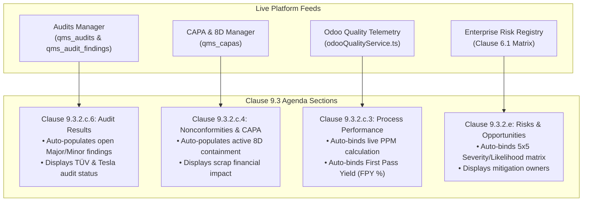

# ISO 9001:2015 Clause 9.3 Management Review Architecture

This document specifies the technical architecture, dynamic agenda builder, automated cross-system data binding, and action item traceability of the **Management Review Cockpit** in Quality Compass.

---

## 1. Regulatory Context (ISO 9001:2015 Clause 9.3)

ISO 9001:2015 Clause 9.3 mandates that top management review the organization's Quality Management System at planned intervals to ensure its continuing suitability, adequacy, effectiveness, and alignment with the strategic direction of the enterprise.

Quality Compass implements this requirement in `src/components/qms/QmsManagementReview.tsx`, transforming what is often a static slide presentation into an active, auditable digital workflow.

---

## 2. Standard ISO 9001:2015 Review Agenda Topics

When a new review is initialized, Quality Compass pre-populates the mandatory standard review inputs defined in Clause 9.3.2:

```
┌────────────────────────────────────────────────────────────────────────┐
│               ISO 9001:2015 Clause 9.3 Standard Agenda                 │
├─────────────┬──────────────────────────────────────────────────────────┤
│ 9.3.2.a     │ Status of actions from previous management reviews       │
│ 9.3.2.b     │ Changes in external and internal issues (Context)        │
│ 9.3.2.c.1   │ Customer satisfaction and feedback from relevant parties │
│ 9.3.2.c.2   │ The extent to which quality objectives have been met     │
│ 9.3.2.c.3   │ Process performance & conformity (Live Odoo PPM / Yield) │
│ 9.3.2.c.4   │ Nonconformities & corrective actions (Active 8D CAPAs)   │
│ 9.3.2.c.5   │ Monitoring and measurement results                       │
│ 9.3.2.c.6   │ Audit results (Internal, TÜV Registrar, Customer Tesla)  │
│ 9.3.2.c.7   │ Performance of external providers (Suppliers & Vendors)  │
│ 9.3.2.d     │ Adequacy of resources (Staffing, equipment, tooling)     │
│ 9.3.2.e     │ Effectiveness of actions taken to address risks (6.1)    │
│ 9.3.2.f     │ Opportunities for continuous improvement (Kaizen)        │
└─────────────┴──────────────────────────────────────────────────────────┘
```

---

## 3. Dynamic Agenda Customization Engine

While standard clauses are mandatory for ISO compliance, executive leadership often needs to incorporate facility-specific or operational topics:

### Extensibility Features:
- **Add Custom Topic Modal:** Enables users to append specialized topics (e.g., *"Claremont Plant 2 Expansion"*, *"Makers Automation Robotic Cell 4 Commissioning"*, *"Q3 Safety & OSHA Recordable Review"*).
- **Topic Configuration:**
  - Topic Title & Clause Target.
  - Presenter / Department Lead.
  - Allotted Discussion Time (minutes).
  - Detailed Discussion Notes & Evidence.
  - Evaluation Status: `CONFORMING`, `EXCELLENT`, `ACTION_REQUIRED`, or `PLANNED`.
- **Dynamic Reordering & Deletion:** Non-mandatory custom topics can be removed or reprioritized without affecting standard clause compliance.

---

## 4. Automated Cross-System Data Binding (Live Tie-Ins)

To eliminate manual data duplication, Quality Compass dynamically binds real-time data from other modules directly into relevant agenda sections:



---

## 5. Action Item Traceability & Closure Verification

ISO 9001 Clause 9.3.3 mandates that management reviews produce clear decisions and actions relating to opportunities for improvement, QMS changes, and resource needs.

Quality Compass manages action items through a formal verification lifecycle:

```
[Open Action Item] 
        │
        ▼ (Assigned Owner, Due Date, Priority: HIGH / MED / LOW)
[In Progress]
        │
        ▼ (Action Completed by Owner + Completion Notes)
[Completed]
        │
        ▼ (Independent QA Verification Dialog)
[Verified Closed] ──> Records verified_by, verified_at, and objective evidence
```

### Verification Dialog Fields:
- **Verification Evidence:** Objective records (e.g., updated SOP, engineering change order, calibration record).
- **Verified By:** Quality Director / Plant Manager name.
- **Verification Timestamp:** Immutable ISO date string stored in `qms_review_actions`.

---

## 6. Executive Sign-Off & Printable Minutes

- **Status Progression:** Review moves from `SCHEDULED` $\rightarrow$ `CONDUCTED` $\rightarrow$ `COMPLETED`.
- **High-Fidelity Printable View (`@media print`):** Formats complete minutes with corporate facility headers, attendee lists, individual clause evaluations, embedded live metrics, risk tables, assigned action items, and executive sign-off lines.
- **Database Persistence:** Stored in Supabase table `qms_management_reviews` and `qms_review_actions`.
