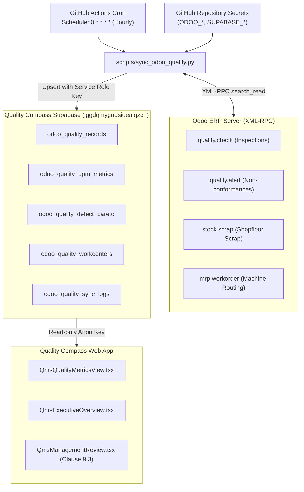

# Live Odoo Quality Telemetry & PPM Engine

This document details the mathematical models, metric calculation engines, Pareto analysis, work center yield scoring, automated hourly sync pipeline, and ERP integration powering the **Live Quality Performance** module in Quality Compass.

---

## 1. Overview & Architecture

The Quality Performance module bridges shopfloor manufacturing execution in Odoo ERP with executive quality monitoring.

Primary Source Files:
- `scripts/sync_odoo_quality.py` — Server-side Python sync pipeline running hourly via GitHub Actions.
- `.github/workflows/odoo_quality_sync.yml` — Hourly cron workflow (`0 * * * *`) that executes the sync script.
- `src/services/odooQualityService.ts` — Frontend service querying live synced quality telemetry from Supabase.
- `src/components/qms/QmsQualityMetricsView.tsx` — Live interactive analytics cockpit displaying KPI cards, trend charts, Pareto bars, and discrepancy tables.
- `src/components/qms/QmsOdooSettingsModal.tsx` — Status modal displaying hourly cron execution state and required secrets.
- `supabase/migrations/20261012_odoo_quality_tables.sql` — Schema migration for synced quality tables in Supabase.

---

## 2. Inviolable Security Standard: Zero Credentials in Frontend

Following the operational standard established by the NHIMM Odoo Operations Dashboard:
- **No Odoo credentials (URL, DB, Username, Password, API Key) are stored in the client-side code or browser `localStorage`.**
- Synchronization is 100% server-side via **GitHub Actions** and encrypted repository secrets.
- The frontend web application is read-only via Supabase Row Level Security (RLS) using anonymous keys.

---

## 3. Mathematical Formulations & Quality Metrics

Quality Compass calculates two distinct, mathematically sound quality metrics from Odoo ERP shopfloor and warehouse movements:

### A. In-Process Manufacturing (MO Scrap PPM & FPY)
Calculated from completed Manufacturing Orders (`mrp.production` where state is `done` or `to_close`) compared directly against shopfloor scrap records linked to manufacturing orders (`stock.scrap` where `production_id != False`).

$$\text{MO Scrap PPM} = \left( \frac{\text{MO Scrap Quantity}}{\text{Total Pieces Produced on MOs}} \right) \times 1{,}000{,}000$$

$$\text{First Pass Yield (FPY \%)} = \left( 1 - \frac{\text{MO Scrap Quantity}}{\text{Total Pieces Produced on MOs}} \right) \times 100\%$$

*Enterprise Thresholds for NHIMM Claremont Shopfloor:*
- **World-Class Automotive Target:** $\text{MO Scrap PPM} \le 150$
- **Acceptable Tier-1 Heavy Duty:** $151 \le \text{PPM} \le 500$
- **First-Pass Yield Target:** $\text{FPY} \ge 99.85\%$

### B. Finished Goods Customer Return PPM (Rolling 12 Months: Make vs Buy)
Calculated from completed stock movements (`stock.move` where `state = 'done'` over the trailing 365 days):
- **Customer Deliveries (Sold):** `location_dest_id` is a customer location and `location_id` is non-customer.
- **Customer Returns:** `location_id` is a customer location and `location_dest_id` is an internal location.

Products are strictly partitioned into **Make** (manufactured parts with active BOMs in `mrp.bom` or completed MOs in `mrp.production`) and **Buy** (resale / purchased finished goods):

1. **Make (Manufactured FG Return PPM):**
   $$\text{Make FG PPM} = \left( \frac{\text{Make Units Returned (12M)}}{\text{Make Units Sold (12M)}} \right) \times 1{,}000{,}000$$

2. **Buy (Purchased FG Return PPM):**
   $$\text{Buy FG PPM} = \left( \frac{\text{Buy Units Returned (12M)}}{\text{Buy Units Sold (12M)}} \right) \times 1{,}000{,}000$$

3. **Total Enterprise FG Return PPM:**
   $$\text{Total FG PPM} = \left( \frac{\text{Total Customer Returned Units (12M)}}{\text{Total Customer Sold Units (12M)}} \right) \times 1{,}000{,}000$$

### C. Zero Seeded Fallback Standard
Neither Quality Compass nor `scripts/sync_odoo_quality.py` injects synthetic placeholder numbers (`quantity_inspected: 1000, quantity_rejected: 1, calculated_ppm: 1000`). When no scrap or defects exist, rates calculate to clean zeros ($0\text{ PPM}$, $100.0\%\text{ FPY}$) rather than arbitrary fallbacks.

---

## 4. Defect Pareto Analysis (80/20 Rule)

Implemented in `compute_rollups()` in `scripts/sync_odoo_quality.py` and `src/services/odooQualityService.ts`:

Defects are aggregated by primary failure mode, sorted descending by occurrence, and assigned cumulative percentage distributions to isolate the vital few root causes:

$$\text{Individual Percentage}_i = \left( \frac{\text{Count}_i}{\sum \text{Counts}} \right) \times 100\%$$

$$\text{Cumulative Percentage}_k = \sum_{i=1}^k \text{Individual Percentage}_i$$

---

## 5. Automated Hourly GitHub Actions Sync Pipeline

Workflow: `.github/workflows/odoo_quality_sync.yml`  
Script: `scripts/sync_odoo_quality.py`



### Deployment Option A: GitHub Actions (Default Managed Cloud)
Runs via `.github/workflows/odoo_quality_sync.yml` on cron `0 * * * *` with repository secrets.

### Deployment Option B: AWS Lightsail Standalone Cron (Direct Linux Host)
For teams running an AWS Lightsail instance (e.g., Ubuntu LTS):
1. **Clone repository & install dependencies**:
   ```bash
   git clone <REPO_URL> /opt/quality-compass
   cd /opt/quality-compass
   sudo apt update && sudo apt install -y python3 python3-pip
   pip install supabase
   ```
2. **Configure environment credentials**:
   Copy `scripts/.env.example` to `/opt/quality-compass/.env`:
   ```bash
   sudo cp /opt/quality-compass/scripts/.env.example /opt/quality-compass/.env
   sudo nano /opt/quality-compass/.env
   ```
   Fill in `ODOO_URL`, `ODOO_DB`, `ODOO_USER`, `ODOO_API_KEY`, `SUPABASE_URL`, and `SUPABASE_SERVICE_ROLE_KEY`.
3. **Configure crontab**:
   Open crontab (`crontab -e`) and add:
   ```bash
   0 * * * * /usr/bin/python3 /opt/quality-compass/scripts/sync_odoo_quality.py >> /var/log/odoo_quality_sync.log 2>&1
   ```
   The script automatically auto-detects and parses `/opt/quality-compass/.env`.
4. **Log rotation (Optional)**:
   Add a standard `logrotate` entry in `/etc/logrotate.d/odoo-quality-sync` to keep logs manageable.

### Required Secrets & Environment Variables:
1. `ODOO_URL`: Base URL of the Odoo instance (e.g. `https://odoo.nhi-mfg.com` or `https://nhimm.odoo.com`).
2. `ODOO_DB`: Database name (e.g. `nhimm` or `odoo_prod`).
3. `ODOO_USER`: Sync user login (or `ODOO_USERNAME`).
4. `ODOO_API_KEY`: API Key or Password.
5. `SUPABASE_URL`: `https://jggdqmygudsiueaiqzcn.supabase.co`.
6. `SUPABASE_SERVICE_ROLE_KEY`: Supabase secret service role key (grants write permissions to sync tables).

---

## 6. Discrepancy & Quarantine Logger

`QmsQualityMetricsView.tsx` renders a detailed discrepancy table tracking shopfloor quality alerts:
- **Discrepancy Identifiers:** Odoo Alert Code (e.g., `QA-2026-089`), Lot Number, and Work Order.
- **Product & Customer Association:** Product SKU, Customer Name, and Work Center.
- **MRB Quarantine State:** Highlighting lots under Material Review Board hold with active red badges.
- **Resolution Stages:** Progression across `New` $\rightarrow$ `Confirmed` $\rightarrow$ `Action Proposed` $\rightarrow$ `Resolved`.
- **Financial Scrap Impact:** Direct dollar scrap and rework costs associated with each non-conformance.
