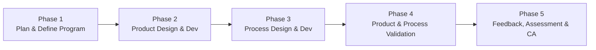

# Pillar 3: APQP & PPAP Launch Hub

This document details the engineering launch lifecycle, 18-element AIAG Production Part Approval Process (PPAP), and multi-tab spreadsheet generation powering **Pillar 3** in Quality Compass.

---

## 1. Overview & Business Intent

Pillar 3 provides a standardized, phase-gated New Product Introduction (NPI) framework for NHI Mechanical Motion LLC. It aligns all four operating companies with the automotive **AIAG 4th Edition APQP/PPAP Manual** and European **VDA 2** guidelines.

The central component `src/components/apqp/ApqpPpapDashboard.tsx` orchestrates project milestones, risk analyses, metrology validation, and customer warrant submissions.

---

## 2. The 5 APQP Phases

Quality Compass structures every product launch into 5 consecutive phase gates:

1. **Phase 1: Plan & Define Program**
   - Voice of Customer (VOC) inputs, business plan review, preliminary BOM, and high-level launch schedules.
2. **Phase 2: Product Design & Development**
   - Design FMEA (DFMEA), Design for Manufacturability (DFM/DFA), engineering drawing releases, material specifications, and prototype builds.
3. **Phase 3: Process Design & Development**
   - Process Flow Diagram (PFD), Process FMEA (PFMEA), Pre-Launch Control Plan, floor layout, packaging standards, and operator work instructions.
4. **Phase 4: Product & Process Validation**
   - Production trial run (Run-at-Rate), Measurement System Analysis (Gage R&R), Initial Process Capability ($C_{pk} / P_{pk} \ge 1.67$), dimensional layout inspection, and PPAP submission.
5. **Phase 5: Feedback, Assessment & Corrective Action**
   - Full-rate serial production, early production containment (safe launch), scrap reduction, customer delivery tracking, and lesson-learned retrospectives.

---

## 3. The 18 AIAG PPAP Elements Matrix

Defined in `src/services/apqpPpapSupabase.ts` via `DEFAULT_AIAG_18_ELEMENTS`:

| # | Element Name | Standard Form / Output | Quality Compass Implementation |
| :---: | :--- | :--- | :--- |
| **1** | Design Records | Ballooned CAD Drawings | Direct bridge to Pillar 1 CAD Canvas |
| **2** | Authorized Engineering Change Documents | ECN / ECO Forms | Attachment upload modal (`PpapDocumentsModal.tsx`) |
| **3** | Customer Engineering Approval | STA Sign-off | Attachment with approval metadata |
| **4** | Design FMEA (DFMEA) | AIAG-VDA DFMEA Table | `PpapFmeaManager.tsx` (Design mode) |
| **5** | Process Flow Diagrams | Process Flow Chart | `PpapProcessFlow.tsx` (Step-by-step visual routing) |
| **6** | Process FMEA (PFMEA) | AIAG-VDA PFMEA Table | `PpapFmeaManager.tsx` (Process mode) |
| **7** | Control Plan | AIAG Control Plan | `PpapControlPlan.tsx` (Pre-Launch & Production) |
| **8** | Measurement System Analysis (MSA) | Gage R&R Study ($< 10\%$) | Integrated MSA results table |
| **9** | Dimensional Results | AIAG Form CFG-1003 | `PpapDimensionalResults.tsx` (Synced to CAD balloons) |
| **10** | Material / Performance Test Results | Mill Test Certs / Hardness | Material test attachment repository |
| **11** | Initial Process Studies | $C_{pk} / P_{pk} \ge 1.67$ SPC | Capability calculations on critical dimensions |
| **12** | Qualified Laboratory Documentation | ISO/IEC 17025 Accreditations | Internal & external lab scope certs |
| **13** | Appearance Approval Report (AAR) | AIAG AAR (CFG-1002) | Conditional (Flagged N/A for raw machined hubs) |
| **14** | Sample Production Parts | Tagged Golden Samples | Shipping tracking & quarantine location |
| **15** | Master Sample | Retained Golden Part | Quality Vault storage tracking record |
| **16** | Checking Aids & Fixtures | Fixture Certification Log | Inspection gage calibration & repeatability logs |
| **17** | Customer-Specific Requirements (CSR) | OEM Matrix Compliance | Audit compliance checklist |
| **18** | Part Submission Warrant (PSW) | AIAG Form CFG-1001 | `PpapWarrantForm.tsx` (Interactive & printable) |

---

## 4. Key Sub-Modules

### A. Part Submission Warrant (PSW - Form CFG-1001)
Component: `src/components/apqp/PpapWarrantForm.tsx`
- Captures part name, customer part number, revision, purchase order number, supplier plant code, IMDS registration ID, submission level (Level 1 through Level 5), and declaration checkboxes.
- Generates high-fidelity printable warrants (`@media print`) and vector PDFs via `src/services/aiagPdfGenerator.ts`.

### B. Dimensional Results (Form CFG-1003)
Component: `src/components/apqp/PpapDimensionalResults.tsx`
- Dynamically binds to the ballooned dimensions from Pillar 1 CAD canvas via `src/utils/apqpSyncEngine.ts`.
- Captures nominals, upper/lower limits, and 5-piece sample measurement data, automatically evaluating in-tolerance status.

### C. FMEA Manager (DFMEA & PFMEA)
Component: `src/components/apqp/PpapFmeaManager.tsx`
- Implements AIAG-VDA failure mode scoring:
  $$\text{RPN} = \text{Severity (S)} \times \text{Occurrence (O)} \times \text{Detection (D)}$$
- Automatically flags high-risk items ($\text{RPN} > 100$ or Severity $\ge 8$) requiring mandatory corrective actions.

### D. Run-at-Rate & Capacity Analysis
Component: `src/components/apqp/PpapCapacityAnalysis.tsx`
- Verifies production line rate against customer quoted volume:
  $$\text{Net Capacity} = \text{Total Operating Hours} \times \text{Parts Per Hour} \times \text{OEE} \times (1 - \text{Scrap Rate})$$
- Evaluates whether shift capacity satisfies contracted Peak Daily Volume (PDV) with a required 15% safety buffer.

---

## 5. Dynamic AIAG Excel Workbook Generation

Implemented in `src/utils/aiagExcelService.ts` using **ExcelJS**:

Quality Compass packages an official AIAG 4th Edition workbook template (`public/templates/PPAP_Forms_Workbook_4th_Edition.xlsx` / `.xltm`). When the user clicks **Export AIAG PPAP Workbook**:
1. ExcelJS loads the master workbook into memory.
2. It populates live project metadata into the `PSW (CFG-1001)` sheet (Part Number, Supplier Details, Submission Level).
3. It writes ballooned layout dimensions and 5-sample data into the `Dimensional (CFG-1003)` sheet.
4. It compiles Process Flow, PFMEA, and Control Plan data into their respective native sheets.
5. It triggers an instant browser download preserving original fonts, borders, print areas, and formula cells.
